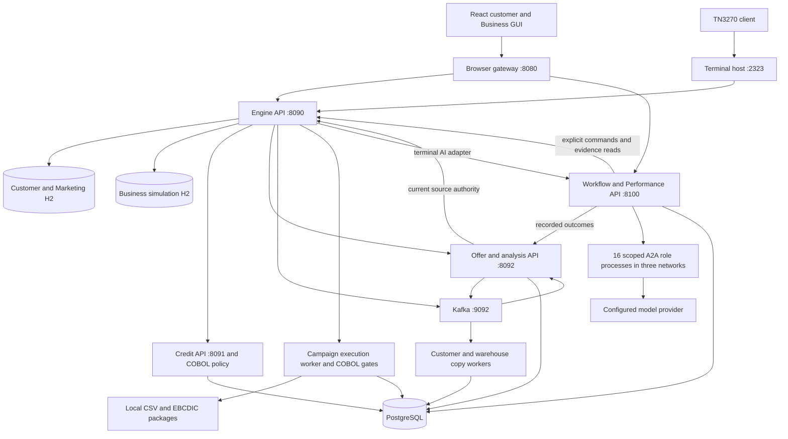
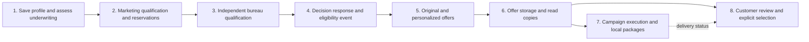
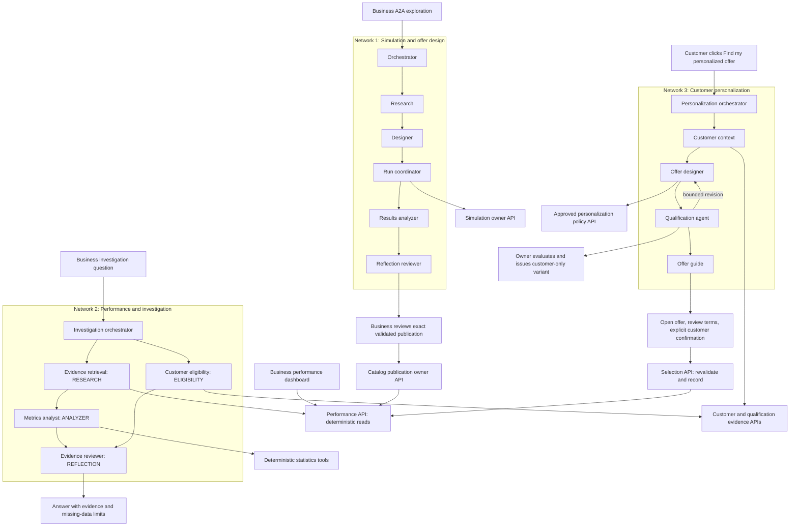

# Offer Generation Mainframe architecture

Updated against this checkout on **2026-11-07**. Scope: `Offer_Generation_Mainframe` only. Start with the [GUI walkthrough](../README.md) or [terminal walkthrough](terminal-walkthrough.md); the design summaries cover [scalability](scalability.md), [DDD](domain-driven-design.md), and [API-first](api-first.md).

This is a local lending demonstration with a Java service host, portable COBOL policy programs, a real TN3270 interface, a React GUI, PostgreSQL/Kafka workers, isolated synthetic experiments, and three logically separated A2A networks. It does not deploy to z/OS/CICS or implement bank authentication. Live A2A calls an external model provider; approved policy excerpts and customer facts used in those calls do not remain exclusively on the local machine.

## 1. Runtime and owner APIs

The global presenter control calls the separate local maintenance contract in `contracts/presenter.openapi.json`. The gateway validates local origin, CSRF, confirmation and request ID, then invokes a serialized coordinator. The coordinator parks the base/AI process supervisors, truncates owned PostgreSQL history, cuts the six application Kafka streams, removes the two H2 stores and generated packages, and restarts the workers to restore defaults. Demo A2A then seeds its reviewed fixtures through owner APIs. Successful preparation returns the exact customer, draft and catalog identities for the completion dialog. Durable request receipts prevent duplicate resets; maintenance blocks workspace traffic and completion expires browser identities. Configuration, source policy files and backups remain. This operational path is local-only and does not place lending rules in the GUI.

The arrows show application dependencies; Kafka delivers versioned facts asynchronously. A browser read model is not authority for a write. Selection, issuance, and publication recheck the relevant owner state.

| Process/boundary | Default listener | Owner and persistence |
| --- | --- | --- |
| Browser gateway | `127.0.0.1:8080` | Serves `frontend/dist`; `/web-api/` maps sessions and requests to owner APIs; sessions are in memory |
| Main Java host | HTTP `8090`, TN3270 `2323` | Customer, Marketing qualification/catalog, automatic pipeline, simulation, source authority, copy/execution coordination |
| Local credit service | HTTP `8091` | Independent bureau profiles and COBOL credit decisions; PostgreSQL bureau persistence |
| Marketing offer service | HTTP `8092` | Generated/personalized offers, exact variants, selections, storage events, stateless Business analysis; PostgreSQL `marketing_offers` |
| AI facade / simulation orchestrator | HTTP `8100` | All three workflow runtimes, performance reads, publication links, budgets, and artifacts; PostgreSQL `ai_orchestrator` |
| Other A2A role processes | Ports listed below | Separate role/network credentials, task handling, and per-role PostgreSQL schemas |
| Kafka | `9092` | Durable event transport; local single-broker deployment |
| PostgreSQL relay | `15432` | Compose relay to the user's Windows PostgreSQL server on `5432`; no database is installed by Compose |

Local host listeners are loopback-only. Kafka/relay infrastructure has its own Compose port configuration. Base runtime wiring lives in [services Main](../services/src/main/java/com/lending/engine/Main.java), offers in [marketing Main](../marketing-service/src/main/java/com/lending/offers/Main.java), and AI in [AI Main](../ai-service/src/main/java/com/lending/ai/Main.java).

## 2. Customer event flow: eight stages

1. **Customer and underwriting.** `CustomerEngine` validates a proposed profile through domain rules and the COBOL adapter, then atomically saves a new profile version and assessment history. Expected-version checks reject conflicting edits. Imported decisions retain source identity/provenance; import order does not silently replace current authority. Unknown numeric facts are distinct from zero.
2. **Marketing qualification.** `PipelineEngine` resumes durable work after a save. `MarketingEngine` applies current catalog/campaign configuration, underwriting status, preferences, consent, suppression, and capacity. Qualification previews freeze inputs; finalization rechecks state and atomically saves reservations. Customer and Marketing share a local transaction to prevent finalization racing a profile update.
3. **Bureau qualification.** `BureauEngine` creates durable requests for finalized marketing qualifications. A separate credit API evaluates independent synthetic/imported/edited bureau facts through COBOL. The self-reported customer score is not the bureau score. Workers claim requests, retry dependencies, and retain decision provenance/version/expiry.
4. **Decision response.** `ResponseEngine` projects bureau outcomes into versioned qualification responses and outbox events, including withdrawals when current authority is lost. Downstream consumers use those facts rather than guessing eligibility from an old profile.
5. **Offer generation.** The marketing service consumes `marketing.qualification.updated.v1`, checks source authority through the engine API, and produces original/personalized offer variants. Deterministic cohort/fit and financial calculations support term personalization. This ordinary path exists without a customer A2A run.
6. **Offer storage.** Versioned storage updates, including `offers.storage.updated.v1`, feed separate customer and warehouse read copies. Consumers reconcile with the repository API and reject duplicate/stale updates. Copies can lag behind their source.
7. **Campaign execution.** Execution reads the offer repository, rechecks current gates, applies COBOL suppression/channel/throttle rules, and writes local CSV/EBCDIC artifacts with manifests. It records status in its own schema. It does not send real email, SMS, or mail.
8. **Presentation and choice.** GUI/terminal show current qualified variants and financial comparisons. The customer reviews and explicitly confirms exact terms. Selection revalidates profile, qualification, policy/offer authority, and the variant; stale or changed terms require another review. Customer visibility/selection is independent of outbound delivery throttling. A saved choice is not loan origination or funding.

`PipelineEngine` directly coordinates early stages; response, offer, copy, and execution workers continue downstream asynchronously. Saving is not one distributed transaction spanning all eight stages. Profile/decision history is preserved, and progress endpoints expose pending/stopped states.

## 3. Domain boundaries and storage

| Context | Important source location | Store / consistency boundary |
| --- | --- | --- |
| Customer/underwriting | `services/.../domain`, `application`, `infrastructure` | H2 `runtime/customer-engine`; profile/decision history and identity constraints |
| Marketing qualification/catalog | `services/.../marketing` | Same H2 transaction as Customer; catalog/config revisions, immutable qualification results, lifecycle/reservations |
| Bureau/credit/response | `services/.../bureau`, `credit`, `response` | PostgreSQL durable requests, independent facts, decisions, response/outbox state |
| Offer source and personalization authority | `services/.../offers` | Owner checks over current customer, qualification, offer and policy versions; exposed through API |
| Offer generation/selection | `marketing-service/.../application`, `domain`, `infrastructure` | PostgreSQL `marketing_offers`; variants, selections, models, inbox/outbox |
| Customer/warehouse copies | `services/.../storage` | PostgreSQL `customer_offer_read` and `enterprise_offer_warehouse`; derived views |
| Campaign execution | `services/.../execution` | PostgreSQL `campaign_execution`, plus `runtime/outbound/` local artifacts |
| Business simulations | `services/.../simulation` | Separate H2 `runtime/business-simulations`; frozen synthetic populations, draft versions, runs/reports |
| AI workflows and measurements | `ai-service/src/main/java/com/lending/ai/` | Central workflow/budget store plus per-role task/artifact schemas |

The abbreviated `services/...` root is `services/src/main/java/com/lending/engine/`; the marketing root is `marketing-service/src/main/java/com/lending/offers/`.

Customer/Marketing separation is modular, not independently deployed microservices. Replacing their shared transaction with remote calls would require an explicit redesign of reservation/version guarantees. Read copies are projections, not new owners of eligibility. Database migrations and fixed-width contracts are operational artifacts: retain existing checksums and add versioned migrations for schema changes rather than deleting runtime databases to “upgrade.”

### COBOL versus Java

[app/cbl](../app/cbl) contains policy programs and batch adapters; [app/cpy](../app/cpy) defines record layouts. Examples include underwriting `LIUW01C`, marketing `LIMK01C`, credit `LICB01C`, offer policy `LIOF01C`, and execution `LIEX01C`. Batch adapters handle files and invoke policy programs. Java owns HTTP, workflow orchestration, versioning, persistence, and format conversion; it does not provide a permissive alternate path when policy execution fails.

The [COBOL record contract](../contracts/cobol-records.md) preserves widths, units, flags, and field ordering. TN3270 is a real model-2/CP037 local terminal implementation; JCL samples and portable COBOL are not evidence of an operational CICS, RACF, Db2, or VSAM deployment.

## 4. Business experiments and publication

A Business experiment freezes a baseline catalog offer/campaign/rules and a synthetic cohort, then versions a candidate's terms and permitted underwriting/marketing/bureau rules. Paired baseline/candidate runs use the same frozen population/date and invoke the COBOL policy path plus the marketing service's deterministic analysis API. They record aggregate, held-out, cohort, and per-customer results in the separate simulation store. Synthetic experiment people do not become active customers, reservations, or delivery recipients.

Manual experiments require review before publication. Network 1 adds constrained agent planning, evidence, a bounded search, and a separate untouched final-validation population. Both paths ultimately use the publication owner command. Publication creates a new catalog offer/campaign with frozen tested rules; it does not mutate the baseline. A changed draft or expired AI preview requires fresh testing/review. The catalog receipt and the AI publication/prediction link are distinct records with retry/reconciliation handling, not a claimed cross-database atomic transaction.

The simulated acceptance statistic is derived from an uncalibrated utility model. It is useful for comparing synthetic alternatives under stated assumptions; it is not an observed acceptance rate or a validated probability forecast.

## 5. Three A2A networks

This diagram groups responsibilities, not an unrestricted peer mesh. Workflow controllers validate and route typed A2A tasks, manage revisions/budgets, and invoke explicit owner commands. Cross-network task routing is rejected. Networks cooperate through published artifacts and owner APIs; an investigation may motivate a separately authorized simulation, but cannot run it implicitly.

### Actual roles and ports

| Network | Role processes and default ports | Workflow owner |
| --- | --- | --- |
| `SIMULATION` | ORCHESTRATOR `8100`, RESEARCH `8101`, DESIGNER `8102`, COORDINATOR `8103`, ANALYZER `8104`, REFLECTION `8105` | [WorkflowService](../ai-service/src/main/java/com/lending/ai/WorkflowService.java) |
| `FEEDBACK` | ORCHESTRATOR `8110`, RESEARCH `8111`, ANALYZER `8114`, REFLECTION `8115`, ELIGIBILITY `8116` | [InvestigationWorkflowService](../ai-service/src/main/java/com/lending/ai/InvestigationWorkflowService.java) |
| `PERSONALIZATION` | ORCHESTRATOR `8120`, DESIGNER `8122`, ELIGIBILITY `8126`, CONTEXT `8127`, GUIDE `8128` | [PersonalizationWorkflowService](../ai-service/src/main/java/com/lending/ai/PersonalizationWorkflowService.java) |

Ports follow the role enum offsets; gaps are intentional. `AI_BASE_PORT`, `AI_FEEDBACK_BASE_PORT`, and `AI_PERSONALIZATION_BASE_PORT` can override bases. There are **16 role processes**. They have separate network credentials, accepted roles, task records, and schemas: `ai_<role>`, `ai_feedback_<role>`, and `ai_personalization_<role>`.

**Deployment limitation:** all three workflow controllers currently run behind the compatibility facade on port `8100`, using its central workflow/budget store. Networks 2 and 3 have separate agent groups, but their durable workflow runtimes are not independent deployments. `Main` wires their scoped tools back to this facade. `-PerformanceOnly` starts the API without agent workers, so the general dashboard remains available without a model key; the API/PostgreSQL/offer dependencies still need to be healthy.

### Responsibilities and tools

| Network / agent | Responsibility | Current tool or owner connection |
| --- | --- | --- |
| Simulation Orchestrator | Resolve objective, missing material decisions, scope, limits | Typed plan and budget state; no catalog publication authority |
| Simulation Research | Find approved evidence and parameter support | Local policy index; optional allowlisted MCP reads |
| Simulation Designer | Propose allowed search dimensions and candidate rules | Parameter registry and frozen draft/evidence |
| Simulation Coordinator | Coordinate bounded exploration/refinement/final validation | Workflow invokes Simulation API commands |
| Simulation Analyzer | Interpret deterministic trial/cohort/validation results | Persisted simulation artifacts |
| Simulation Reflection | Review evidence, limitations, and proposed winners | Typed claims, result and policy evidence |
| Investigation Orchestrator | Split compound questions and resolve date/offer/customer scope | Typed investigation plan and clarification |
| Investigation Research | Retrieve immutable prediction and recorded outcome evidence | `performance.evidence` |
| Investigation Eligibility | Trace exact historical customer/variant decisions | `eligibility.trace` |
| Investigation Analyzer | Obtain count-based rates and comparisons | `statistics.measure`, `statistics.compare` |
| Investigation Reflection | Check definitions, dates, citations, and missing data | `evidence.review` |
| Personalization Orchestrator | Bind work to customer/profile version and budget | Versioned workflow and explicit owner commands |
| Personalization Context | Compare saved facts, prior offers, and changes | `customer.context` |
| Personalization Designer | Propose terms/rule changes inside approved limits | `personalization.limits` |
| Personalization Eligibility | Inspect authoritative candidate qualification | `qualification.result`; workflow requests owner evaluation |
| Personalization Guide | Explain the qualified result and supported GUI actions | `journey.steps`; no ability to accept for the customer |

The named built-in tools above are scoped internal tools, not automatically installed MCP servers. [mcp-servers.json](../ai-service/config/mcp-servers.json) currently has an empty server list. [McpTools](../ai-service/src/main/java/com/lending/ai/McpTools.java) supports explicitly configured network/role/read-only allowlists, approved input schemas, bounded output, HTTPS or loopback HTTP, and no redirects. Discovery does not grant new authority. Simulation execution, issuance, publication, and acceptance remain explicit application commands.

Policy evidence is read by the simulation Research process; approved read access can be shared without granting another network its write authority. `PolicyIndex`/`PolicyExtractor` scan local files, extract text, and bind approval to content hash, product, and expiry. OCR is optional. The reusable demo templates are in [app/data/policies](../app/data/policies); private runtime evidence is copied into `policy-documents/` or `AI_POLICY_DIR`. Untrusted document text is evidence, not an instruction source that can override tools or domain limits.

### Customer personalization authority

The network starts only when the customer clicks **Find my personalized offer**, after saving and qualifying the current profile. It uses past offers for context, then chooses from currently qualified baselines. `CustomerPersonalizationPolicy` is versioned and time-bound; the present `CUSTOMER-2026-001` policy is effective from 2026-01-01 to 2028-01-01. It allows approved term variations and bounded **tightening** of the DTI/tenure rules, not a general relaxation of failed eligibility. Consent, suppression, bureau identity, and imported declines remain fixed authority.

The owner validates exact candidates, verifies a permitted improvement, and issues a variant for that customer/profile; shared catalog rules remain unchanged. Guidance returns supported actions such as `OPEN_OFFER` and `REVIEW_TERMS`. The customer still confirms selection. Profile/policy/terms changes or expiry trigger revalidation. No improvement, cancellation, timeout, or a budget stop is a valid result; existing valid offers remain usable. Default limits are three candidates, ten model calls, 300,000 tokens, the configured $15 ceiling, and 180 seconds. The saved profile version identifies an idempotent run.

## 6. Prediction and recorded-performance contract

The general dashboard calls the Performance API directly. `OutcomeService` retains publication predictions and imports recorded evidence; `PerformanceService`, `MeasurementScope`, and `PerformanceMeasurements` compute/query scope and metrics. Network 2 explains these results and combines aggregate questions with individual traces. It does not rewrite the original prediction, infer absent historical facts, or execute new simulation trials.

| Measure/scope | Required interpretation |
| --- | --- |
| Eligibility | Eligible customers divided by assessed customers in the defined scope; unavailable if the assessed denominator was not recorded |
| Acceptance | Distinct customers with a recorded selection divided by eligible customers, under a defined follow-up window |
| Period aggregate | Combine numerator/denominator counts; do not average daily percentages without weighting |
| Date basis | Default first assessment; first eligible is an explicit alternative |
| Dates/timezone | Inclusive selected local dates, default `America/Los_Angeles`, normalized to a bounded interval and evidence cutoff |
| Source mode | Native local activity is `DEMO`; explicitly configured real-source evidence remains separate as `OBSERVED_REAL` |
| Offer scope | Offer family, original variant, and exact personalized variant are different scopes; retain offer/rule/profile version where available |
| Maturity/coverage | Follow-up defaults to 14 days; reconciliation/maturity checks and missing source history can keep results provisional or unavailable |
| Forecast comparison | `SIMULATED_UTILITY` / `CATALOG_TERMS_ONLY` does not automatically match observed family acceptance; show a forecast gap only when backend comparability permits it |
| Missing individual history | “Not recorded,” never an invented “ineligible” decision |

The native demo feed may lack full assessment/admission history. A successful selection does not fill that gap. A configured external outcome source requires validated source identity and evidence; setting a label does not turn synthetic observations into real outcomes. Exact personalized eligibility requires the relevant profile, variant, rule, and decision evidence, rather than a generic product match.

## 7. Interfaces, security, and consistency

- **Contracts:** [contracts](../contracts) contains OpenAPI, AsyncAPI, JSON Schema, and fixed-width COBOL contracts. [sync-gui-contract.mjs](../scripts/sync-gui-contract.mjs) checks the generated browser contract and its referenced owner definitions. Typed A2A envelopes/results live in [Contracts.java](../ai-service/src/main/java/com/lending/ai/Contracts.java); agents expose `/.well-known/agent-card.json` and `/a2a` task transport.
- **Presentation:** [frontend/src](../frontend/src) renders forms, tables, statuses, and supported guide actions. [WebServer](../services/src/main/java/com/lending/engine/web/WebServer.java) keeps owner credentials server-side and enforces local session/customer routing plus origin/CSRF protections. These demo sessions are not real account/password access control.
- **Commands:** expected versions and idempotency keys where implemented protect retries/stale edits. Publication and acceptance have separate explicit review. A model's proposed terms or textual eligibility claim is insufficient authority.
- **Events:** transactional outbox/inbox, version checks, retries, and reconciliation support at-least-once delivery. There is no global transaction across H2, PostgreSQL, Kafka, and model calls. Readiness means listeners/dependencies respond, not that every future job or provider request succeeds.
- **Credentials and privacy:** runtime token/key files are local operational state. Do not rotate/delete them just to fix a port conflict. Model-backed workflows can send task evidence externally and incur cost. Optional MCP connections are separately configured, bounded read channels.
- **Recovery and limits:** the launchers use singleton locks; current simulation and A2A workers have bounded capacity. Inspect workflow/job states and logs before retrying. Unfinished AI workflows can resume after restart, subject to current authority/deadlines. The H2 stores, shared workflow facade, per-role connection serialization, in-memory browser sessions, and single local Kafka broker remain scaling/availability limits.

## 8. Repository map and operations

| Path | Contents |
| --- | --- |
| `app/cbl`, `app/cpy`, `app/jcl` | COBOL policies/adapters, copybooks, and host-oriented JCL samples |
| `app/data` | Seed/configuration inputs and reusable demo policy templates |
| `services/src/main/java/com/lending/engine` | Customer/Marketing host, adapters, bureau/response/storage/execution, simulation, TN3270, and web gateway |
| `marketing-service/src/main/java/com/lending/offers` | Offer domain, deterministic personalization/analysis, repository, and API |
| `ai-service/src/main/java/com/lending/ai` | All three workflows, A2A roles/tools, model adapter, policy evidence, and deterministic performance |
| `frontend/src` | Customer/Business React views and API client |
| `contracts` | Operational public interface specifications; retained outside the six reader guides |
| `scripts` | Setup/build/run/check commands, contract synchronization, and relocated maintenance SQL |
| `policy-documents` | Private runtime evidence; excludes its former redundant usage guide |
| `runtime` | Local configuration, credentials, H2 files, scratch/output, AI logs, and other private runtime state |
| `docs` | The five supporting guides; the root README is the GUI guide |

Use the walkthroughs for exact setup, inputs, buttons, menus, publication approval, and shutdown. `build.ps1` runs base default tests; `build-ai.ps1` checks AI; `build-gui.ps1` checks contracts/client/gateway and builds assets. Opt-in integrations use configured PostgreSQL/Kafka and are not proof of live-model behavior. The moved [reset SQL](../scripts/reset-customers-keep-catalog.h2.sql) applies only to its documented H2 scope, not all downstream stores. Keep operational migrations, API contracts, and policy data intact during documentation cleanup.
