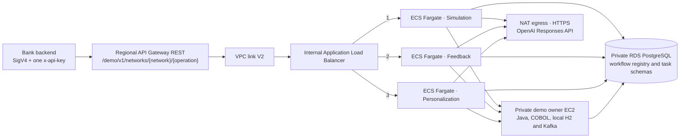

# Deploy the three A2A networks on AWS

**Reference deployment · us-east-1 · Emma Woodhouse Bank synthetic data**

Deploy one Regional API Gateway REST API, one usage plan, and one API key. The request path parameter `network` selects an independently replaceable ECS service. A trusted bank backend signs its request with AWS Signature Version 4 and sends the same `x-api-key` for all three networks.

| `network` | Service | Example operation |
|---|---|---|
| `1` | Simulation | `POST /demo/v1/networks/1/workflows` |
| `2` | Feedback | `POST /demo/v1/networks/2/investigations` |
| `3` | Personalization | `POST /demo/v1/networks/3/customers/{customerId}` |

This runbook provisions the three networks plus a fresh, private copy of the existing Java/COBOL bank owner so the initial installation can exercise real owner interfaces. Use a sandbox AWS account with synthetic records. For a bank integration, the owner is the bank's authenticated service, reached over approved private connectivity. The three A2A services keep their independent deployment boundaries either way.

All AWS resource creation in this runbook uses the **AWS Management Console**. Four CloudFormation templates fill in the settings that would otherwise need to be entered by hand. One AWS Console wizard creates the VPC link. The local Python command builds the upload archive. CloudShell and Systems Manager commands perform identity lookup, signed verification, and synthetic fixture setup. The image build runs in CodeBuild.

**Validation.** The four templates were checked against the us-east-1 CloudFormation resource specification. The application image built locally, all 16 role listeners passed readiness, and the owner prepared the synthetic fixture against isolated PostgreSQL and Kafka with model egress disabled. Complete the signed checks in step 8 after your first AWS deployment, and use step 10 to check your provider access.

[Console setup](#1-prepare-the-account-and-record-two-values) · [Verify the key and routes](#8-verify-the-deployed-endpoint-with-the-actual-key-and-role) · [Network requests](#10-call-all-three-networks-with-the-same-key) · [Operations](#11-operate-diagnose-and-update-the-deployment) · [Cost and teardown](#13-cost-and-teardown)

## Deployment decision



| Decision | Reason |
|---|---|
| REST API, with `AWS_IAM` plus a usage key | REST API usage plans support `x-api-key`. IAM supplies caller identity. The usage plan supplies best-effort request metering and throttling across all three routes. |
| One Fargate service per network | Each task runs the exact six, five, or five role JVMs for its network. The Java roles retain the existing loopback A2A JSON-RPC, callbacks, and role credentials. ECS replaces and deploys each group independently. |
| One VPC link V2 and one internal ALB | The ALB uses path rules to choose the target group. The ALB and tasks have private addresses. AWS supports ALB integration for REST through VPC links V2. |
| Cloud Map and fixed-port relays | Cloud Map supplies stable private peer names. The packaged relays preserve the existing localhost addresses for legacy Simulation forwarding, Feedback policy lookup, and the mainframe's `AiProxy`. The public bridge accepts a reviewed set of REST paths. |
| RDS PostgreSQL Multi-AZ, one bank database | All three orchestrators use the existing `ai_orchestrator` registry. The role processes keep their schema names. The bank owner holds H2 and Kafka on encrypted local EBS and uses RDS for its PostgreSQL-backed services. |
| CodeBuild, private ECR, Secrets Manager, CloudWatch | CodeBuild builds Linux Java and COBOL artifacts and mirrors the repo's Kafka version. ECR retains immutable release tags. Secrets Manager supplies credentials. CloudWatch records build and service diagnostics. |
| OpenAI Responses API over HTTPS | `AstraClient` uses an OpenAI project key, a Responses model, and strict structured output. Keeping that interface preserves the agent contracts. Each private subnet reaches the provider through the NAT gateway in its Availability Zone. |

**Why this fits the checked-out code.** [Main.java](../ai-service/src/main/java/com/lending/ai/Main.java) constructs loopback clients and reads credential files. [Server.java](../ai-service/src/main/java/com/lending/ai/Server.java) binds Java to `127.0.0.1`. [Store.java](../ai-service/src/main/java/com/lending/ai/Store.java) takes PostgreSQL advisory locks for single-role ownership and holds a JDBC session. The supplied image adds packaging, peer relays, a public-route allowlist, and two build-only adjustments for RDS certificate validation and model selection. Quote approval, bureau decisions, publication, and acceptance remain owner operations. Runbook releases use **one task per network per bank** and stop the old task before starting its replacement. There is a brief service interruption during that replacement.

**Alternatives evaluated.**

| Option | Fit for this deployment |
|---|---|
| HTTP API | Lower-cost API option for a JWT/IAM-only client contract. REST fits the required usage plan and shared key. |
| Lambda | Suitable for short stateless adapters. The existing Java processes supervise background tasks, poll persistent state, maintain A2A listeners, and hold PostgreSQL locks. Fargate preserves that process lifecycle. |
| ECS Express Mode, App Runner, and EKS | Express Mode is useful for a simpler web service. Here the shared REST front door, custom private routes, Cloud Map and one-writer rollout settings benefit from standard ECS service controls. AWS has closed App Runner to new customers. EKS adds cluster operations for this size. |
| SQS, Step Functions, and EventBridge | Useful for a future queue-backed execution layer. The existing application owns its job state and state machine in PostgreSQL. It has no SQS worker, claim lease, or transactional dispatch adapter to configure today. |
| Amazon Bedrock | Bedrock offers OpenAI-compatible Responses on supported endpoint/model combinations. Switching providers requires a tested model ID, base URL, auth, strict-schema behavior, usage accounting, and regression results. Using a Bedrock API key as `OPENAI_API_KEY` against the existing OpenAI endpoint would fail. |
| Amazon MSK | Appropriate when deploying a managed bank-owner event stream. This demo keeps the repository's local broker on the owner instance. A production migration must also configure the owner Kafka clients for the chosen MSK TLS/auth mode and retain replay semantics. |

AWS references. [REST versus HTTP APIs](https://docs.aws.amazon.com/apigateway/latest/developerguide/http-api-vs-rest.html), [REST usage plans](https://docs.aws.amazon.com/apigateway/latest/developerguide/api-gateway-api-usage-plans.html), [REST private integrations](https://docs.aws.amazon.com/apigateway/latest/developerguide/private-integration.html), [ECS Fargate](https://docs.aws.amazon.com/AmazonECS/latest/developerguide/fargate-tasks-services.html), [ECS service discovery](https://docs.aws.amazon.com/AmazonECS/latest/developerguide/service-discovery.html), [RDS Multi-AZ](https://docs.aws.amazon.com/AmazonRDS/latest/UserGuide/Concepts.MultiAZSingleStandby.html), [App Runner availability](https://docs.aws.amazon.com/apprunner/latest/dg/apprunner-availability-change.html), [Bedrock inference APIs](https://docs.aws.amazon.com/bedrock/latest/userguide/apis.html), [SQS delivery semantics](https://docs.aws.amazon.com/AWSSimpleQueueService/latest/SQSDeveloperGuide/standard-queues.html).

## 1. Prepare the account and record two values

1. Sign in to the AWS Console in an isolated **sandbox account** using an IAM or IAM Identity Center administrator role. Use a principal that can create CloudFormation stacks and the resources they contain, acknowledge and pass IAM roles, manage the source bucket, use CloudShell, view API keys, and run SSM commands. The test identity must be allowed to assume the caller role that the gateway stack creates. Account SCPs, permission boundaries, and quotas must allow these operations.
2. In the Console top bar, choose your Region, then choose **US East (N. Virginia)**. Use this Region for every step. In **Service Quotas**, confirm that the account has capacity for two NAT gateway Elastic IP addresses, one ALB, one Multi-AZ PostgreSQL DB instance, one on-demand `t3.large`, one Linux CodeBuild build, and four on-demand Fargate vCPUs. Use a sandbox with at least two available AZs. The foundation uses the first two from `Fn::GetAZs`.
3. In the top bar, click **CloudShell** (terminal icon). If the welcome dialog appears, choose **Close**. Use the standard public CloudShell environment in us-east-1. At the Bash prompt, paste the following block and press **Enter**. The block reads account metadata. Copy the two printed values into a local deployment note.

```bash
export AWS_DEFAULT_REGION=us-east-1
identity=$(aws sts get-caller-identity --query Arn --output text)
case "$identity" in
  arn:aws:sts::*:assumed-role/*)
    role_name=$(cut -d/ -f2 <<< "$identity")
    trusted_arn=$(aws iam get-role --role-name "$role_name" --query Role.Arn --output text)
    ;;
  arn:aws:iam::*:user/*) trusted_arn="$identity" ;;
  *) echo "Sign in as an IAM user or role with deployment permissions."; return 1 2>/dev/null || exit 1 ;;
esac
owner_ami=$(aws ssm get-parameter --name /aws/service/ami-amazon-linux-latest/al2023-ami-kernel-default-x86_64 --query Parameter.Value --output text)
printf 'TrustedCallerArn=%s\nOwnerAmi=%s\n' "$trusted_arn" "$owner_ami"
```

Use the returned IAM ARN, including any role path, for `TrustedCallerArn`. For the `OwnerAmi` parameter, paste the returned `ami-…`. This pins the AMI during future agent-only updates.

4. Have an **OpenAI project API key** with Responses API access and a known compatible model ID. The repo's current configured value is `gpt-6-astra`. Use it if your project can invoke it with structured outputs. For another approved Responses model, enter its actual ID in `ModelId` in step 5. A missing or unauthorized model can pass container health and still fail live requests. Check access and budget on the provider side before starting the live examples.
5. Open **Secrets Manager** from the Console search bar. Choose **Store a new secret**. For **Secret type**, choose **Other type of secret**, choose **Plaintext**, and paste the raw OpenAI project key with no surrounding quotes or JSON. Leave the default AWS-managed encryption key selected. Choose **Next**.
6. Set **Secret name** to `ogm/emma/openai`. Choose **Next**. Leave automatic rotation off for the manually issued key and choose **Next**. On **Review**, choose **Store**. From the secrets list, select `ogm/emma/openai` and copy the **Secret ARN** from **Secret details**. Record it as `OpenAiSecretArn`. ECS task execution retrieves the secret by ARN. The task definition contains the ARN.

[AWS CloudShell](https://docs.aws.amazon.com/cloudshell/latest/userguide/getting-started.html) · [AL2023 public AMI parameters](https://docs.aws.amazon.com/linux/al2023/ug/ec2.html) · [Secrets Manager console steps](https://docs.aws.amazon.com/secretsmanager/latest/userguide/create_secret.html) · [ECS secret injection](https://docs.aws.amazon.com/AmazonECS/latest/developerguide/secrets-envvar-secrets-manager.html)

## 2. Use this CloudFormation wizard for each template

Follow this same screen sequence for the four **Create stack** instructions below.

1. In Console search, open **CloudFormation**. Choose **Stacks** in the navigation pane. Choose **Create stack** → **With new resources (standard)**.
2. On **Create stack**, under **Prepare template**, choose **Choose an existing template**. Under **Specify template**, select **Upload a template file**, then choose **Choose file**. Select the stated JSON file under `Offer_Generation_Mainframe/docs/aws-a2a/` and choose **Open** in the file picker. Wait for the uploaded template reference. Choose **Next**.
3. On **Specify stack details**, set **Stack name** and fill each parameter exactly as listed for that template. Choose **Next**.
4. On **Configure stack options**, leave tags, execution role and advanced options at their defaults. Use the normal rollback behavior. If **Capabilities** is shown, select **I acknowledge that this template may create IAM resources**. Choose **Next**.
5. On **Review and create**, check the stack name, template and parameters. Choose **Submit**. Open the new stack's **Events** tab and use **Refresh** until its top-level status is `CREATE_COMPLETE`. If it rolls back, open the first resource with `CREATE_FAILED` and read **Status reason** before retrying. After `ROLLBACK_COMPLETE`, select the failed stack, choose **Delete**, confirm with **Delete stack**, and recreate after correcting the cause.
6. Open the stack's **Outputs** tab and record the outputs requested below. Stack references use the names in this guide.

[CloudFormation console wizard](https://docs.aws.amazon.com/AWSCloudFormation/latest/UserGuide/cfn-console-create-stack.html)

## 3. Create the foundation and upload the source ZIP

1. Run the wizard above with [foundation.json](aws-a2a/foundation.json). Use stack name `ogm-foundation`. There are no parameters. Wait for `CREATE_COMPLETE`.
2. In **Outputs**, copy `VpcId`, `PrivateA`, `PrivateB`, `LinkSecurityGroup`, `SourceBucket`, `RepositoryName` and `OwnerLogGroup`. The template creates the two-AZ VPC, two NAT gateways, private PostgreSQL with Multi-AZ failover and backups, scoped security group rules, a private versioned source bucket, ECR, generated demo secrets, and log groups.
3. On Windows, open **PowerShell**, change to the mainframe project folder, and run the packaging helper. The ZIP excludes `runtime/`, credentials, test results, local databases, Docker volumes and version-control metadata. Only the checked-in application sources, synthetic policy fixtures, and build helpers are included.

```powershell
Set-Location -LiteralPath 'C:\Users\tanek\code\AWS\Case-Study-1\Offer_Generation_Mainframe'
python .\docs\aws-a2a\package-source.py --output "$env:USERPROFILE\Downloads\ogm-source-r001.zip"
```

4. In Console search open **S3**. Under **General purpose buckets**, click the bucket matching `SourceBucket`. On **Objects**, choose **Upload** → **Add files**. Select `ogm-source-r001.zip` in **Downloads** and choose **Open**. Leave the object at the bucket root and retain the bucket's encryption. Choose **Upload**. Wait for **Succeeded**, then choose **Close**. On **Objects**, confirm the exact key `ogm-source-r001.zip` with no folder prefix.
5. Keep the source bucket private. The CodeBuild role receives read access to this one source object when you create the next stack.

[S3 console upload](https://docs.aws.amazon.com/AmazonS3/latest/userguide/GetStartedWithS3.html) · [RDS PostgreSQL certificate verification](https://docs.aws.amazon.com/AmazonRDS/latest/UserGuide/PostgreSQL.Concepts.General.SSL.html)

## 4. Build the images with CodeBuild

1. Use the wizard with [build.json](aws-a2a/build.json). Set **Stack name** to `ogm-build`, **FoundationStack** to `ogm-foundation`, and **Release** to `r001`. Acknowledge IAM capabilities. After `CREATE_COMPLETE`, record the `BuildProject` output.
2. In Console search open **CodeBuild**. In the left navigation choose **Build projects**. Click the project matching `BuildProject`, then choose **Start build**. Use its saved settings. The project runs a privileged Linux Docker build from the uploaded ZIP. The build publishes the bank/A2A image and the Kafka image into ECR.
3. On the build details page, open **Build logs**. Wait until the overall **Build status** reads **Succeeded**. Follow the first failed command in the log if the build fails. A missing source key reports an error in `DOWNLOAD_SOURCE`. Registry pull, Maven artifact or outbound dependency failures show up in the build logs. The images compile from the current code using Linux Java 17 and GnuCOBOL.
4. Open **Elastic Container Registry** in the Console. Choose **Private registry** → **Repositories**. Click the repository matching `RepositoryName`. On **Images**, confirm both `ogm-r001` and `kafka-r001` are present. Record the digest for each. A failed build that already published one immutable tag requires a fresh release suffix. Upload `ogm-source-r002.zip`, update the build stack's `Release` to `r002`, and build again.

[Run a CodeBuild build](https://docs.aws.amazon.com/codebuild/latest/userguide/run-build-console.html) · [ECR immutable tags](https://docs.aws.amazon.com/AmazonECR/latest/userguide/image-tag-mutability.html)

## 5. Deploy the bank owner and three ECS services

1. Use the wizard with [runtime.json](aws-a2a/runtime.json). Enter these values on **Specify stack details**.

   | Console field | Value |
   |---|---|
   | **Stack name** | `ogm-runtime` |
   | **FoundationStack** | `ogm-foundation` |
   | **Release** | `r001` |
   | **OwnerRelease** | `r001` |
   | **OwnerAmi** | The `ami-…` value from step 1 |
   | **OpenAiSecretArn** | The full `ogm/emma/openai` ARN from step 1 |
   | **ModelId** | `gpt-6-astra` if available to the project, or the verified Responses model ID |

2. Acknowledge IAM capabilities and choose **Submit**. On **Events**, the `Owner` resource signals readiness after it has pulled the two ECR images, created the `ogm_app` database login, started Kafka on loopback, and checked the owner and Offer APIs. The EC2 bootstrap grants the app login schema creation in its single bank database. It uses the RDS-generated master secret only for bootstrap. Each ECS service then starts its own network task.
3. After `CREATE_COMPLETE`, choose **Outputs**. Record `OwnerInstanceId`, `EcsCluster`, and `AlbArn`.
4. Open **Elastic Container Service** → **Clusters** → the cluster matching `EcsCluster` → **Services**. Confirm `simulation`, `feedback`, and `personalization` each have one running task and one desired task. To inspect a startup, click the service → **Tasks** → its running task ID → **Logs**. Stopped task details show pull, secret, container health, and exit reasons.
5. Open **EC2** → **Target Groups** under **Load Balancing**. Use the runtime stack's **Resources** tab to match the physical IDs of `SimulationTarget`, `FeedbackTarget`, and `PersonalizationTarget` if needed. Open each group and choose **Targets**. Confirm one IP target on port `8080` with status **Healthy**. If there is no target, inspect that service's **Events** tab. If it is registered but **Unhealthy**, inspect its task logs and its readiness check. The bridge checks the versioned network and role identity of every expected JVM.
6. The deployment settings are `0%` minimum and `100%` maximum during replacement with desired count `1`. Keep those values. A second task of the same network competes for the same advisory locks. Other networks can remain up during a single-network rollout, with the documented dependency of Feedback policy lookup on Simulation Research.

[AWS ECS rolling deployment behavior](https://docs.aws.amazon.com/AmazonECS/latest/developerguide/deployment-type-ecs.html) · [ECS DNS service discovery](https://docs.aws.amazon.com/AmazonECS/latest/developerguide/service-discovery.html) · [RDS Multi-AZ failover](https://docs.aws.amazon.com/AmazonRDS/latest/UserGuide/Concepts.MultiAZ.Failover.html)

## 6. Create the REST VPC link in the console

1. In Console search open **API Gateway**. In the main navigation, choose **VPC links**. If the navigation is collapsed, open it with the menu icon. Choose **Create**.
2. Under **Choose a VPC link version**, select **VPC link V2**. Enter **Name** `ogm-a2a-link`.
3. Under **VPC**, select `VpcId` from step 3. In **Subnets**, select exactly the two IDs `PrivateA` and `PrivateB`. Under **Security groups**, select `LinkSecurityGroup`. Remove a preselected default security group if present. Choose **Create**.
4. On **VPC links**, wait for `ogm-a2a-link` to show **Available**. Copy its displayed **ID** and record it as `VpcLinkId`. Use the displayed ID value. The link creates private ENIs. Provisioning takes several minutes. A link that remains unused long enough can become inactive, and needs time to reprovision when called.

[AWS REST VPC link console procedure](https://docs.aws.amazon.com/apigateway/latest/developerguide/getting-started-with-private-integration.html) · [VPC link V2 lifecycle](https://docs.aws.amazon.com/apigateway/latest/developerguide/apigateway-vpc-links-v2.html)

## 7. Deploy the REST API, stage, caller role and one key

1. Use the wizard with [gateway.json](aws-a2a/gateway.json). Enter **Stack name** `ogm-gateway`, **RuntimeStack** `ogm-runtime`, **VpcLinkId** from step 6, and **TrustedCallerArn** from step 1. Acknowledge IAM capabilities, submit, and wait for `CREATE_COMPLETE`.
2. In **Outputs**, record `InvokeUrl`, `ApiId`, `KeyId`, and `CallerRoleArn`. Open **API Gateway** → **APIs** → `ogm-gateway-rest` → **Resources**. Expand `/v1` → `/networks` → `/{network}` → `/{proxy+}`. Choose **GET**, then **POST**. On each method's **Method request** tab, confirm **Authorization** is `AWS_IAM` and **API key required** is enabled.
3. On each method's **Integration request** tab, confirm **VPC link** with proxy integration and the `ogm-a2a-link` ID. The template maps `method.request.path.network` and `method.request.path.proxy` to the corresponding integration path parameters, and sets the internal ALB ARN as integration target. The backend supports both the unprefixed integration path and the path including `/demo`. The ALB selects targets only for `1`, `2`, and `3`. The bridge independently validates the number and route.
4. In the API navigation, choose **Stages** → **demo**. Confirm **Invoke URL** matches the stack output. The template creates a deployment and associates it with this stage.
5. In the main API Gateway navigation, choose **Usage plans** → `ogm-gateway-usage`. In the plan details, verify **Associated API stages** contains `ogm-gateway-rest` and `demo`. Under **API keys** in that plan, confirm `ogm-gateway-key` is associated. The plan is shared by all routes. Allow a few minutes for a new key association to take effect.
6. In the main navigation choose **API keys** → `ogm-gateway-key`. Verify the key ID matches `KeyId`. Under **API key details**, use **Show** next to the key value and copy it. Use that same value in `x-api-key` for every network. Treat the value as a secret. A server-side client signs with credentials for `CallerRoleArn`. The caller role's trust permits the single configured IAM principal and the API resource policy denies other principals. The key goes in the server-side request header.

**Verification path.** A TLS connection terminates at API Gateway. The pilot uses private HTTP from VPC link to ALB and between trusted components inside the VPC. Its banking access is fixed to one synthetic owner and one database. The process-specific bearer credentials used internally never come from the incoming request.

[AWS REST private integration settings](https://docs.aws.amazon.com/apigateway/latest/developerguide/set-up-private-integration.html) · [REST API key requirements](https://docs.aws.amazon.com/apigateway/latest/developerguide/api-gateway-setup-api-keys.html) · [IAM authorization and REST resource policies](https://docs.aws.amazon.com/apigateway/latest/developerguide/apigateway-authorization-flow.html)

## 8. Verify the deployed endpoint with the actual key and role

1. Return to **CloudShell** in us-east-1. Use **Actions** → **Upload file** → **Browse**. Select [invoke.py](aws-a2a/invoke.py) from the deployment folder → **Open** → **Upload**. Wait for the upload confirmation. The file appears as `$HOME/invoke.py`.
2. Paste the block below after replacing the two quoted placeholder values. Enter the key value at the hidden prompt, then press **Enter**. Keep this CloudShell session open for the examples. The helper assumes the caller role, signs requests with curl, and feeds credentials to curl through standard input.

```bash
export OGM_INVOKE_URL='PASTE_INVOKE_URL_FROM_OGM_GATEWAY'
export OGM_CALLER_ROLE='PASTE_CALLER_ROLE_ARN_FROM_OGM_GATEWAY'
read -rsp 'API Gateway key value: ' OGM_API_KEY; printf '\n'; export OGM_API_KEY
ogm() { python3 "$HOME/invoke.py" "$@"; }
ogm --verify
```

3. The first three lines must report **HTTP 200** and `SIMULATION`, `FEEDBACK`, and `PERSONALIZATION` respectively. The next probes expect **404** for an unsupported number, **403** when a signed request omits the key, **403** when a request provides the key without a signature, and **404** for a blocked internal path. These are read-only probes. `modelConfigured` verifies credential injection and the chosen model name. The workflow tests below exercise actual provider access.
4. Check the registry with `ogm '/v1/networks/1/workflows?limit=1'` and `ogm '/v1/networks/2/publications'`. An empty array is normal on a new install. API Gateway's built-in **Test** facility is useful for integration debugging. Use the signed invoke URL above to verify authorization and key enforcement on the deployed stage.

[CloudShell file upload](https://docs.aws.amazon.com/cloudshell/latest/userguide/getting-started.html#upload-file) · [AWS API Gateway IAM invocation](https://docs.aws.amazon.com/apigateway/latest/developerguide/api-gateway-iam-policy-examples-for-api-execution.html)

## 9. Prepare reproducible synthetic requests

Run this step only in the fresh synthetic environment. The fixture script checks for existing customers, drafts, runs and publications. If it rejects the environment, inspect the reason and use a fresh environment or the IDs already created from the earlier run.

1. In the Console search bar, open **Systems Manager** → **Run Command**. Choose **Run command**. In **Command document** select `AWS-RunShellScript`.
2. Under **Command parameters**, paste the block below into **Commands**. Set **Execution Timeout** to `900` if that field is shown. Under **Targets**, choose **Choose instances manually**, then select the `OwnerInstanceId` in the runtime stack's Outputs. If the instance does not appear, wait for it to register in **Fleet Manager**. Disable **Enable an S3 bucket** in **Output options** when selected, and leave CloudWatch output disabled for this short synthetic command. Set the delivery **Timeout (seconds)** to `900` if shown, then choose **Run**.
3. On the command details page, wait for **Overall status: Success**. Under **Targets and outputs**, choose the instance ID, then expand **Output**, or select **View output**. Copy `DRAFT`, `DISCOVERY`, `VALIDATION`, `CUSTOMER`, `PROFILE` and `SESSION` into your local deployment note. The session expires one hour after creation.

```bash
set -e
docker exec ogm-owner python3 scripts/seed-presenter-a2a.py --engine-port 8090
docker exec -i ogm-owner python3 - <<'PY'
import json
from datetime import datetime, timezone, timedelta
from pathlib import Path
from urllib.request import Request, urlopen
from uuid import uuid4

r = Path("runtime")
m = json.loads((r / "maintenance/a2a-filming-start.json").read_text())
session = "aws-demo-" + uuid4().hex
req = Request(
    "http://127.0.0.1:8090/api/v1/offer-creation/customers/"
    + m["customerId"] + "/personalization-sessions",
    data=json.dumps({
        "sessionId": session,
        "expiresAt": (datetime.now(timezone.utc) + timedelta(hours=1)).isoformat(),
    }).encode(),
    headers={
        "Authorization": "Bearer " + (r / "api-token").read_text().strip(),
        "Content-Type": "application/json",
    },
    method="POST",
)
with urlopen(req, timeout=10) as response:
    if response.status != 200:
        raise SystemExit("Owner rejected the session")
for k,v in {
    "DRAFT":m["draftId"], "DISCOVERY":m["discoveryPopulation"]["id"],
    "VALIDATION":m["validationPopulation"]["id"], "CUSTOMER":m["customerId"],
    "PROFILE":m["profileVersion"], "SESSION":session,
}.items():
    print(f"{k}={v}")
PY
```

For an already-seeded environment with an expired session, run the second `docker exec` block alone. Refresh `PROFILE` to the bank's latest saved profile version if the customer was edited. In CloudShell paste the six `NAME=value` output lines. Enter them as shell assignments, without the log headings.

[Systems Manager Run Command](https://docs.aws.amazon.com/systems-manager/latest/userguide/run-command.html) · [Current fixture program](../scripts/seed-presenter-a2a.py)

## 10. Call all three networks with the same key

Commands below reuse the `ogm` function and key from step 8. Substitute real IDs from your own synthetic test. **POST workflow commands can incur model charges.** Before running them, review the budget JSON, provider limits and synthetic data. Run only the calls you want to exercise. A create response from the existing REST services is HTTP `200` and includes a workflow ID. Poll that ID rather than holding the API Gateway connection open.

### Network 1 · Simulation

1. Use the bank's fixture IDs to submit an experiment over the two separate prepared 10,000-person cohorts. This obtains a fresh deadline and a valid trial split for 12 evaluations. Review `sim-budget.json` before the create call.

```bash
ogm '/v1/networks/1/defaults?maxEvaluations=12' > sim-budget.json
jq '{maxEvaluations,maxModelCalls,maxTokens,maxCostUsd,deadline,exploration,refinement,validation}' sim-budget.json
SIM_REQUEST="aws-simulation-$(python3 -c 'from uuid import uuid4; print(uuid4().hex)')"
jq -n --arg id "$SIM_REQUEST" --arg draft "$DRAFT" --arg discover "$DISCOVERY" \
  --arg validate "$VALIDATION" --slurpfile budget sim-budget.json \
  '{requestId:$id,draftId:$draft,populationId:$discover,validationPopulationId:$validate,
    intent:"Evaluate whether a lower personal-loan origination fee improves modeled acceptance while maintaining eligibility.",
    lockedStages:["bureau","underwriting","marketing"],autoExecute:false,budget:$budget[0]}' > sim-request.json
ogm /v1/networks/1/workflows --method POST --body sim-request.json > sim-result.json
W1=$(jq -er '.id' sim-result.json)
ogm "/v1/networks/1/workflows/$W1" > sim-result.json
jq '{id,version,state:.workflow.state,question:.workflow.pendingQuestion,error:.workflow.error,usage}' sim-result.json
```

For saved bank customers, the create body uses `"customerPopulation":{"selectedProduct":"PERSONAL_LOAN","feeSensitivity":"HIGHER"}` in place of both population IDs. Use `"customerPopulation":{}` for the unfiltered saved-profile cohort. The owner constructs discovery and validation partitions. The single-customer starter dataset is for the prepared synthetic-cohort example. Use a populated bank cohort for this separate operation.

2. Poll the same GET path every 5–10 seconds. For `NEEDS_INPUT`, read the current prompt and post the analyst's answer with that response's version and question ID. One reply goes to one pending question.

```bash
jq '.workflow.pendingQuestion' sim-result.json
read -rp 'Answer to the current simulation question: ' answer
jq --arg text "$answer" \
  '{expectedVersion:.version,questionId:.workflow.pendingQuestion.id,text:$text}' sim-result.json > sim-answer.json
ogm "/v1/networks/1/workflows/$W1/messages" --method POST --body sim-answer.json > sim-result.json
```

3. At `AWAITING_SCOPE`, inspect the actual proposal with `jq '.workflow.scope' sim-result.json`. If acceptable, send approval bound to its hash and version. Continue polling the workflow ID. For `FAILED` or `PAUSED_BUDGET`, inspect `.workflow.error` and `.usage` before resuming. On a request timeout, first look up the saved workflow or retry the same exact create body with the original `requestId`.

```bash
jq '{expectedVersion:.version,scopeHash:.workflow.scopeHash}' sim-result.json > scope-confirmation.json
ogm "/v1/networks/1/workflows/$W1/scope-confirmations" --method POST --body scope-confirmation.json > sim-result.json
```

4. To exercise Feedback over a published offer, pull the latest result and confirm the simulation is `COMPLETED`. Review `.workflow.winners` and its completed validation evaluations. Choose the reviewed validation candidate ID. Generate an exact preview and inspect the terms, changes and modeled prediction. When the result has no publishable candidate, retain it as a simulation result and evaluate another candidate before proceeding to publication.

```bash
ogm "/v1/networks/1/workflows/$W1" > sim-result.json
jq '{state:.workflow.state,winners:.workflow.winners}' sim-result.json
ogm "/v1/networks/1/workflows/$W1/evaluations"
read -rp 'Reviewed successful validation candidate ID: ' candidate
jq -n --arg candidate "$candidate" \
  '{candidateId:$candidate,note:"Reviewed final validation for the synthetic AWS deployment."}' > preview-request.json
ogm "/v1/networks/1/workflows/$W1/publication-previews" --method POST --body preview-request.json > preview.json
jq '{previewId,previewHash,configuration,changedPaths,prediction,expiresAt}' preview.json
```

5. Only after reviewing the preview, publish to the synthetic bank with this separate request. Record the returned `receipt.offerId`.

```bash
PREVIEW=$(jq -er '.previewId' preview.json)
jq '{previewHash,confirm:true}' preview.json > publish.json
ogm "/v1/networks/1/publication-previews/$PREVIEW/confirm" --method POST --body publish.json > publication.json
PUB=$(jq -er '.receipt.offerId' publication.json)
printf 'Published synthetic offer %s\n' "$PUB"
```

### Network 2 · Feedback

1. Use the same key and set the path selector to `2`. Verify that `ogm /v1/networks/2/publications` includes `$PUB`. This checks that Feedback can read the same bank's publication record. Start an investigation with a fresh budget.

```bash
ogm /v1/networks/2/publications
ogm /v1/networks/2/defaults > feedback-budget.json
F2_REQUEST="aws-feedback-$(python3 -c 'from uuid import uuid4; print(uuid4().hex)')"
jq -n --arg pub "$PUB" --arg id "$F2_REQUEST" --slurpfile budget feedback-budget.json \
  '{publicationId:$pub,requestId:$id,sourceMode:"DEMO",
    text:"Report observed eligibility and acceptance for this published offer. State any missing evidence or denominator.",
    scope:{timezone:"America/Los_Angeles",dateBasis:"FIRST_ASSESSED",variant:"OFFER_FAMILY"},
    budget:$budget[0]}' > feedback-request.json
ogm /v1/networks/2/investigations --method POST --body feedback-request.json > feedback-result.json
W2=$(jq -er '.id' feedback-result.json)
ogm "/v1/networks/2/workflows/$W2" > feedback-result.json
jq '{id,version,state:.workflow.state,question:.workflow.pendingQuestion,error:.workflow.error,usage}' feedback-result.json
```

2. Poll the `2/workflows/$W2` route. For `NEEDS_INPUT`, use the same answer JSON shape as Network 1 and POST it to `/v1/networks/2/workflows/$W2/messages`. The Feedback service interprets recorded outcomes for the publication. A newly published offer may have no measured outcomes. Check coverage and the denominator in the output before treating any rate as a measurement. Owner storage events are consumed through the bank's REST cursor. Use the owner's synthetic assessment and selection records to exercise observed rates.
3. Retrieve an evidence snapshot without asking the model to investigate. This is a direct deterministic measurement route.

```bash
printf '%s\n' '{"timezone":"America/Los_Angeles","dateBasis":"FIRST_ASSESSED","variant":"OFFER_FAMILY","sourceMode":"DEMO"}' > measurement.json
ogm "/v1/networks/2/performance/publications/$PUB/measurements" --method POST --body measurement.json
```

### Network 3 · Personalization

1. Use the customer, profile and session values from step 9. First make the session-scoped GET, which can return `NOT_STARTED`. Then start a conversation for that saved profile on the `3` route. Use the profile version and session supplied by the bank owner.

```bash
ogm "/v1/networks/3/customers/$CUSTOMER?profileVersion=$PROFILE&sessionId=$SESSION"
jq -n --arg session "$SESSION" --argjson profile "$PROFILE" \
  '{profileVersion:$profile,sessionId:$session,
    message:"I prefer a lower upfront fee and would consider a longer repayment term."}' > personal-request.json
ogm "/v1/networks/3/customers/$CUSTOMER" --method POST --body personal-request.json > personal-result.json
W3=$(jq -er '.id' personal-result.json)
ogm "/v1/networks/3/customers/$CUSTOMER/workflows/$W3?sessionId=$SESSION" > personal-result.json
jq '{id,version,state,pendingQuestion,error,usage}' personal-result.json
```

2. If `NEEDS_INPUT`, post a new customer answer using the pending question and the version from the latest customer GET.

```bash
jq '.pendingQuestion' personal-result.json
read -rp 'Answer to the current personalization question: ' answer
jq --arg text "$answer" \
  '{expectedVersion:.version,questionId:.pendingQuestion.id,text:$text}' personal-result.json > personal-answer.json
ogm "/v1/networks/3/customers/$CUSTOMER/workflows/$W3/messages?sessionId=$SESSION" \
  --method POST --body personal-answer.json > personal-result.json
```

3. Poll the session-scoped workflow. A completed quote can be reviewed in the returned result. `NO_QUALIFIED_IMPROVEMENT` is also a valid outcome. Quote selection remains a separate authorized customer request to the owner's offer service. For an expired session or stale profile, refresh the bank identity and version before starting a new request.

[Simulation request and admission](../ai-service/src/main/java/com/lending/ai/WorkflowService.java) · [Feedback request](../ai-service/src/main/java/com/lending/ai/FeedbackService.java) · [Personalization request and session checks](../ai-service/src/main/java/com/lending/ai/PersonalizationWorkflowService.java) · [Existing demo interactions](a2a-demo.md)

## 11. Operate, diagnose, and update the deployment

| Symptom | Console check and corrective action |
|---|---|
| CloudFormation stops at `Owner` | **CloudFormation** → `ogm-runtime` → **Events** → click the failed `Owner` row. On an existing owner, use **Systems Manager** → **Run Command** with `AWS-RunShellScript` and `tail -n 120 /var/log/cloud-init-output.log`. The owner signals success only after its APIs respond. In **CloudWatch** → **Log groups** → `OwnerLogGroup`, look for streams `bank` and `kafka`. A rolled-back instance may no longer be available to inspect. |
| Task will not start | **ECS** → **Clusters** → your cluster → the service → **Tasks**. Filter for **Stopped**, open the latest ID, and read the stopped reason. `CannotPullContainerError` points to the exact ECR tag or subnet egress. `ResourceInitializationError` commonly points to secret read permission, execution role, egress or log initialization. For Java failures, open **Logs**. |
| Overlapping task reports another schema owner | In the service **Update** page set **Desired tasks** `1`, **Min running tasks** `0` and **Max running tasks** `100`. Confirm no task in another service uses the same bank database and role schema. |
| VPC integration 5xx | **API Gateway** → **VPC links** → the link must be **Available**. **EC2** → **Target Groups** → the selected target group → **Targets**. Confirm the service's healthy IP and port. Compare method **Integration request** path mappings and the ALB listener rule for the selected number. |
| Signed request gets 403 | Confirm `InvokeUrl` includes `/demo` once, `CallerRoleArn` is used for SigV4 in `us-east-1`, and the key value comes from `ogm-gateway-key`. On **Usage plans**, confirm the stage and key association. If `sts:AssumeRole` fails, check the bootstrap principal ARN including its IAM path and its permission to assume the caller role. |
| `MODEL_NOT_CONFIGURED` or `MODEL_UNAVAILABLE` | In **Secrets Manager**, verify the plaintext OpenAI secret and its Region. In ECS **Tasks** → **Logs**, inspect the model status and app error without printing the key. Check OpenAI project model access, budget and provider rate limits. After a key change, repeat the ECS force deployment process below. |
| `504` on creation | A synchronous owner request may have exceeded the bridge or Gateway timeout. Check the owner logs and saved workflow before retrying. Use the original exact `requestId` and body for a create retry. Use the prepared cohort IDs for the standard deployment test. |
| Database failover or DB connection errors with a green health check | Open **RDS** → **Databases** → the DB → **Logs & events**, and wait for the writer to become **Available**. Repeat registry reads from step 8. The app retains JDBC sessions. If reads still fail, force new deployments for the affected services. Check the private owner with SSM and restart `ogm-owner` through Run Command if its connection pool does not recover. |
| Customer shows stale profile or expired session | In step 9, open a new owner session with the current profile version. Pass the same ID on start, poll and answer. `NO_QUALIFIED_IMPROVEMENT` is a valid result when the owner has no suitable terms. |

**Force a network deployment.** Open **ECS** → **Clusters** → `ogm-runtime-ecs` → **Services**. Check the affected service → **Update**. Select **Force new deployment**. Keep the current task definition revision, **Desired tasks** `1`, **Min running tasks** `0` and **Max running tasks** `100`. Scroll to **Update** and choose it. On the service page, wait for its deployment to succeed and for its target to return to **Healthy**, then rerun `ogm --verify`. Rotate the OpenAI key by editing the secret value in **Secrets Manager** and forcing each service deployment one at a time. Retain the generated bank seed and app DB password for this environment. Changing either requires a coordinated credential migration.

**Build a new agent release.** Package `ogm-source-r002.zip` and upload it at the same bucket root. In **CloudFormation** → **Stacks** → `ogm-build` choose **Update** → **Make a direct update**. Select **Use existing template** → **Next**. On **Specify stack details**, change `Release` to `r002` → **Next**. On **Configure stack options**, acknowledge IAM → **Next**. On **Review**, choose **Update stack**. Wait for `UPDATE_COMPLETE`, use **CodeBuild** → the saved project → **Start build**, and confirm both new tags in ECR. Update `ogm-runtime` the same way, changing only its agent `Release`. Preserve `OwnerRelease`, `OwnerAmi` and the other parameters. This keeps the demo bank owner instance and H2 files in place. Confirm each service's new task revision and pass step 8 again. To roll back the agents, update the runtime stack's `Release` to the previous immutable tag. Keep a compatible schema and a database recovery point before changes that alter persisted data.

**Change a route.** Change the ALB and the allowlist in the corresponding asset, rebuild and deploy the affected service, and update the gateway method mapping if needed. After modifying an existing REST API's method configuration, open **API Gateway** → the API → **Resources** → **Deploy API**, choose the existing `demo` stage and choose **Deploy**. Record the template change with the release. The fixed initial deployment resource in `gateway.json` represents the first route revision.

[CloudFormation direct update](https://docs.aws.amazon.com/AWSCloudFormation/latest/UserGuide/using-cfn-updating-stacks-direct.html) · [ECS console update steps](https://docs.aws.amazon.com/AmazonECS/latest/developerguide/update-service-console-v2.html) · [Deploy a REST API](https://docs.aws.amazon.com/apigateway/latest/developerguide/how-to-deploy-api.html) · [Secrets and new ECS tasks](https://docs.aws.amazon.com/AmazonECS/latest/developerguide/secrets-envvar-secrets-manager.html)

## 12. Scale and isolate when moving beyond the synthetic bank

1. **Scale tenants and networks as independent units first.** Each tenant environment gets its own verified caller identity, key, owner connection, credentials, DB and worker schema set. The same tenant key selects all three of that tenant's routes. Keep tenant selection tied to the authenticated principal and environment. A `bankId` string sent by a caller has no authority to choose another database. This template defines one Emma bank. A multi-bank entry point would require a tenant-aware authorizer, routing map, storage permissions, and cross-tenant negative tests.
2. **Separate stateless admission from task execution.** Keep the API contract stable. Persist request, tenant, network, idempotency key, budget, and outbox record in the same transaction. Return `202` and a status URL after durable admission in the redesigned service. Dispatch reference-only jobs to an SQS standard queue with a dead-letter queue per network. Scale workers on backlog and task age with provider concurrency controls. Acknowledge the queue message after a durable checkpoint. Make processing idempotent for repeat delivery and use lease fencing and visibility extension. Replace the current single-connection and advisory-lock assumptions before increasing replicas.
3. **Make the bank owner and model boundaries production-grade.** Integrate over bank-approved private connectivity with TLS, tenant-scoped service identity, customer authorization and minimal retrieved data. Use the bank's production owner APIs and durable event sources. Validate provider processing, retention and approved payload fields. Consider a private REST endpoint for banks with VPC access, and use ACM certificates for TLS to the private ALB. Select an AWS provider only after confirming structured output and running the model contract tests with approved data.
4. **Test failure recovery.** Run controlled owner and database failover, agent restart, duplicate job, and model throttling exercises. Gate actual availability and concurrency targets on measured tests. The two-AZ VPC, ALB and RDS improve recoverability. The reference deployment still has one active worker group per network and one synthetic owner instance.

[AWS transactional outbox pattern](https://docs.aws.amazon.com/prescriptive-guidance/latest/cloud-design-patterns/transactional-outbox.html) · [ECS scaling on SQS backlog](https://docs.aws.amazon.com/AmazonECS/latest/developerguide/service-autoscaling-queue.html) · [Private REST API access](https://docs.aws.amazon.com/apigateway/latest/developerguide/apigateway-private-apis.html)

## 13. Cost and teardown

At the documented sample on-demand N. Virginia Linux/x86 rates, three continuously running tasks totaling four vCPUs and 14 GB of task memory are about **$164/month** for 730 hours. Two zonal NAT gateways add about **$66/month** before data and public IPv4 charges. The ALB adds about **$16/month** before load-balancer capacity charges. Add the private Multi-AZ RDS instance and storage, EC2 and EBS, API calls, logs, images, source storage, Secrets Manager, network transfer, builds, and OpenAI usage. Use current account rates in the AWS Pricing Calculator before launching. This is a sizing illustration, and it excludes taxes and discounts. Scaling ECS to zero leaves the owner, network, database and other fixed resources billable. [AWS sample regional rates](https://docs.aws.amazon.com/solutions/latest/prebid-server-deployment-on-aws/cost1.html) · [Public IPv4 and NAT pricing](https://aws.amazon.com/vpc/pricing/) · [AWS Pricing Calculator](https://calculator.aws/)

Use this order if you choose to remove the test environment. Deleting the runtime removes the demo owner's EBS volume and its H2 and Kafka data. Save any synthetic results you need before deletion.

1. In **CloudFormation** → **Stacks**, select `ogm-gateway` → **Delete** → **Delete stack**. Wait for deletion before deleting the link.
2. In **API Gateway** → **VPC links**, select `ogm-a2a-link`, choose **Delete**, confirm the dialog, and wait for the link and its network interfaces to be removed.
3. In **CloudFormation**, delete `ogm-runtime`, then `ogm-build`. Wait for each stack to finish. In **ECR** → **Repositories** → the foundation repository → **Images**, select the test tags → **Delete** → confirm. Check for any remaining untagged image manifests from the same demo repository and remove those if you intend to delete it.
4. In **S3** → **General purpose buckets**, select the source bucket → **Empty**. Enter the confirmation phrase shown and choose **Empty**. This includes uploaded source object versions. Return to **CloudFormation** and delete `ogm-foundation`. The template takes a final RDS snapshot. To retain test results, keep that snapshot. To stop its storage charges, use **RDS** → **Snapshots** to select the demo snapshot and delete it when ready.
5. Open **Secrets Manager** → `ogm/emma/openai` → **Actions** → **Delete secret**. Choose a recovery window and schedule deletion when nothing uses it. Clear credentials in the CloudShell session using `unset OGM_API_KEY OGM_CALLER_ROLE OGM_INVOKE_URL`.

[AWS CloudFormation stack deletion](https://docs.aws.amazon.com/AWSCloudFormation/latest/UserGuide/cfn-console-delete-stack.html) · [Empty an S3 bucket](https://docs.aws.amazon.com/AmazonS3/latest/userguide/empty-bucket.html) · [Secrets Manager scheduled deletion](https://docs.aws.amazon.com/secretsmanager/latest/userguide/manage_delete-secret.html)
